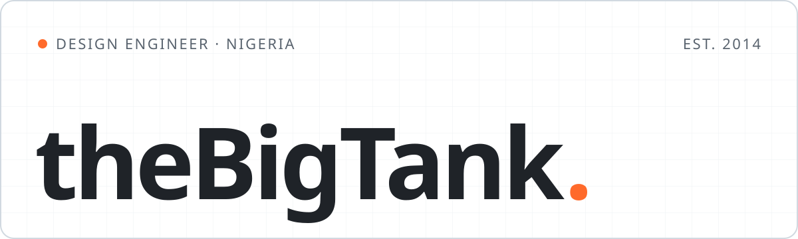
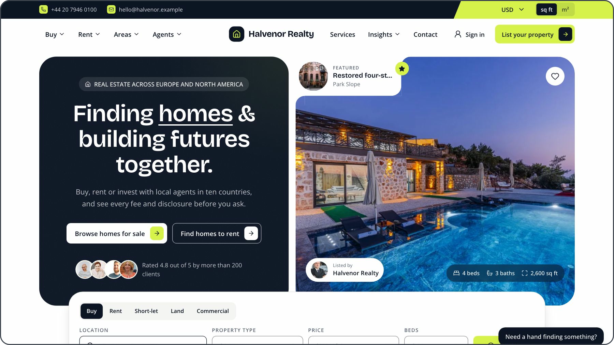
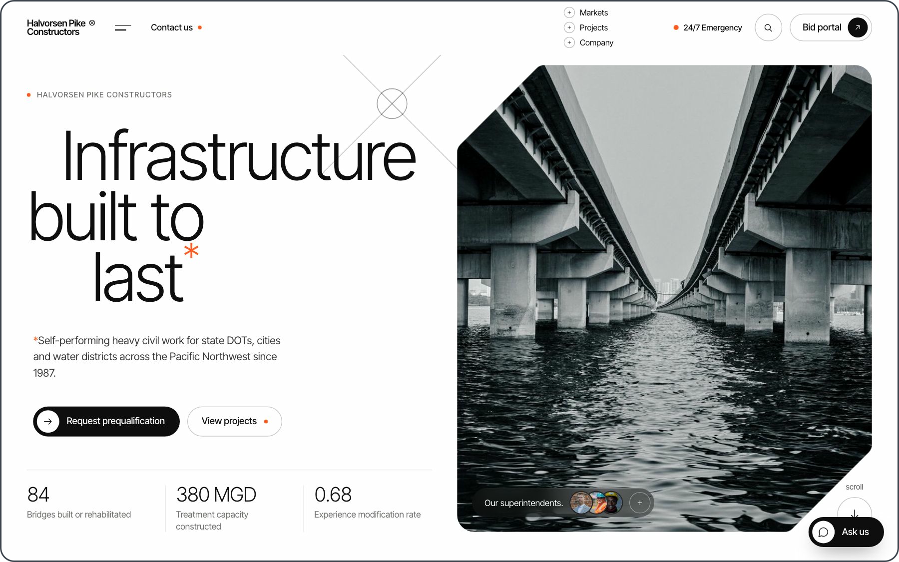
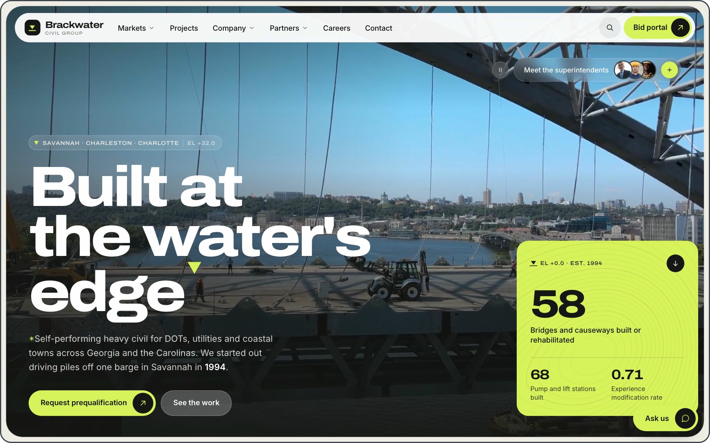
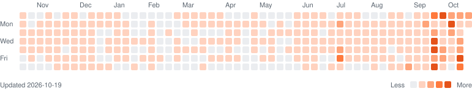

<picture>
  <source media="(prefers-color-scheme: dark)" srcset="assets/banner-dark.svg">
  
</picture>

I turn chaos into order: tidy data, tidy code, tidy process. Laravel, Payload and Flutter, plus the front end that sells it.

&nbsp;&nbsp;&nbsp;&nbsp;

## 01 · Now building

**[Halvenor Realty ↗](https://halvenor.raymanthis.com)** — Real estate site, customer portal and back office across ten countries. 
`Next.js` `Payload CMS` `PostgreSQL`

<table>
  <tr>
    <td width="50%" valign="top">
       
      <b><a href="https://halvorsenpike.raymanthis.com">Halvorsen Pike Constructors ↗</a></b> 
      A heavy civil contractor site template: CMS, bid portal, AI assistant. 
      <code>Laravel</code> <code>Filament</code> <code>Livewire</code>
    </td>
    <td width="50%" valign="top">
       
      <b><a href="https://brackwatercivilgroup.raymanthis.com">Brackwater Civil Group ↗</a></b> 
      The second template on the same backbone, with a whole new look. 
      <code>Laravel</code> <code>Filament</code> <code>Livewire</code>
    </td>
  </tr>
</table>

## 02 · Toolbox

`Laravel` `Filament` `PHP` `Livewire` `Next.js` `Payload CMS` `Flutter` `Dart` `TypeScript` `Vue` `Tailwind` `SCSS` `WordPress`

## 03 · Commit history

<picture>
  <source media="(prefers-color-scheme: dark)" srcset="assets/contributions-dark.svg">
  
</picture>

---

Building something for the real world? **[Let's talk at raymanthis.com ↗](https://raymanthis.com)**
